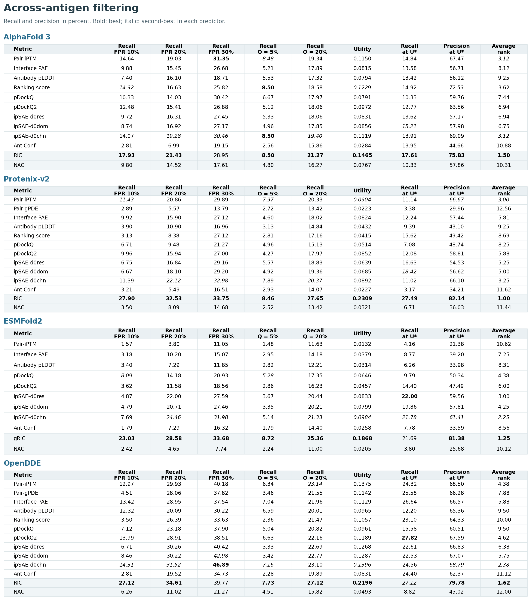
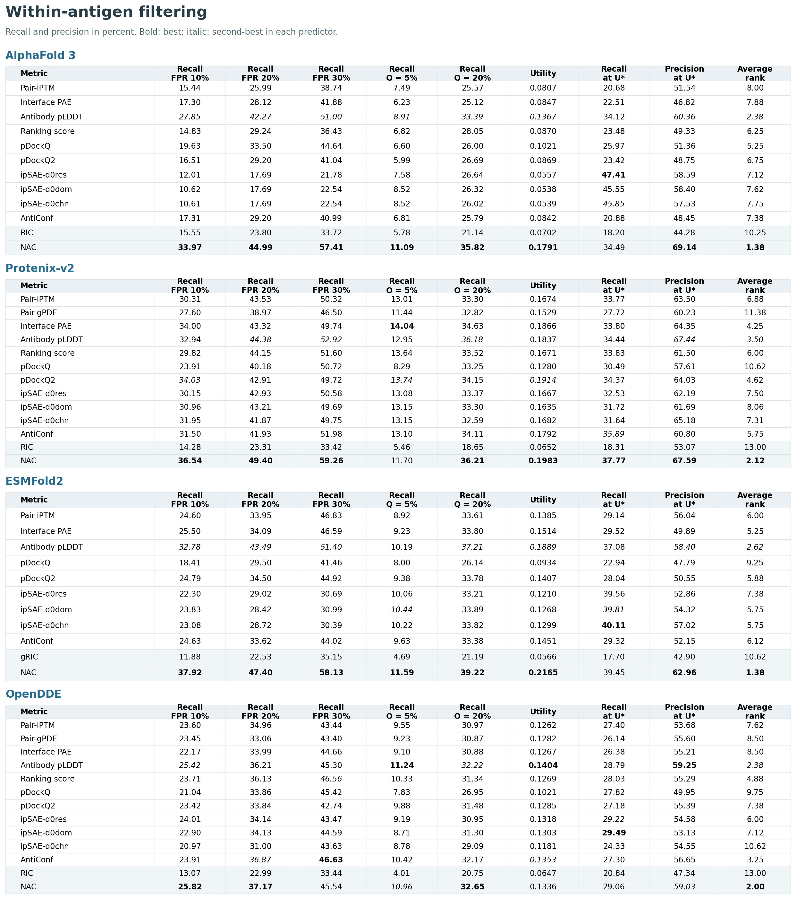

<div align="center">

# Revisiting Structure-Based Filtering for AI-Designed Antibodies

### Opportunities, Limits, and What Matters

**Which signals in predicted structures help select antibodies for experimental testing?**

[](https://arxiv.org/pdf/2610.23136)
[](pyproject.toml)
[](docs/prediction.md)

[Read the paper](https://arxiv.org/pdf/2610.23136) &nbsp; / &nbsp;
[Quick start](#quick-start) &nbsp; / &nbsp;
[Datasets](#datasets) &nbsp; / &nbsp;
[From sequences](#from-sequences-to-scores) &nbsp; / &nbsp;
[Citation](#citation)

</div>

---

Structure prediction produces more than a proposed binding pose. Its confidence
and agreement across repeated predictions can also help prioritize candidates.
We study these signals on **4,184 experimentally characterized antibody-antigen
pairs**, across **four predictors** and **two filtering settings**.

This repository contains RIC and NAC, baseline scores, dataset preparation,
prediction adapters, and the evaluation code accompanying the paper.
Read the paper on [arXiv](https://arxiv.org/abs/2610.23136) or download the
[PDF](https://arxiv.org/pdf/2610.23136).
The [repository manuscript](paper/antibody-filtering.pdf) includes the OpenDDE
extension and the updated regional-confidence figure.

## What matters for filtering?

| Across antigens | Within one antigen |
| :--- | :--- |
| Candidates for different targets compete under a shared threshold or global ranking. | Candidates for the same target are ranked against one another. |
| **Interface evidence** is strongest in our benchmark comparisons. | **Antibody-level confidence**, especially outside the CDRs, is more informative. |
| **RIC** measures support for predicted CDR contacts across prediction runs. | **NAC** summarizes non-CDR antibody pLDDT. |

**NAC remains CDR- and antigen-conditioned.** Its pLDDT values come from
cofolding the complete antibody, including all CDRs, with the antigen. CDR
residues are excluded only from the confidence average used to calculate NAC.

### Table 2: Interface evidence leads in across-antigen filtering

Global filtering on the full benchmark of 4,184 candidates; 275 ESMFold2
out-of-memory complexes are excluded. Recall and precision are percentages.

<a href="https://arxiv.org/pdf/2610.23136">
  
</a>

With one threshold shared across antigens, **RIC has the best average rank** for
AlphaFold 3 (1.50) and Protenix-v2 (1.00), with large gains in low-FPR recall and
utility. Its geometric-contact approximation, **gRIC**, also ranks first for
ESMFold2 (1.25), whereas NAC ranks near the bottom (10.12).
For **OpenDDE**, RIC also ranks first (1.62), with 27.12% recall at a 20% budget
and utility 0.2196; NAC ranks 12.00.

### Table 3: Antibody reliability is strongest within an antigen

Campaign-specific evaluation of 2,400 candidates across 13 display-based and
IgDesign antigens; 107 ESMFold2 out-of-memory complexes are excluded.

<a href="https://arxiv.org/pdf/2610.23136">
  
</a>

**The ordering reverses when candidates compete within the same antigen.** NAC
ranks first for AlphaFold 3 and ESMFold2 (1.38 for both) and remains among the
strongest scores for Protenix-v2 (2.12). RIC falls to average ranks of 10.25 and
13.00 for AlphaFold 3 and Protenix-v2, and gRIC ranks 10.62 for ESMFold2.
OpenDDE follows the same reversal: **NAC ranks first (2.00)**, followed by
whole-antibody pLDDT (2.38), while RIC ranks last (13.00).

**Confidence outside the CDRs is more informative than whole-antibody confidence.**
NAC outperforms antibody pLDDT in 28 of 32 predictor-measure comparisons: all eight
for AlphaFold 3 and ESMFold2, seven for Protenix-v2, and five for OpenDDE.
For OpenDDE, whole-antibody pLDDT has higher utility (0.1404 versus 0.1336),
while NAC has higher recall at a 20% budget (32.65% versus 32.22%).

**Within-antigen filtering offers greater fixed-budget gains.** Testing the top
20% of candidates with NAC recovers 35.82%, 36.21%, 39.22%, and 32.65% of binders with
AlphaFold 3, Protenix-v2, ESMFold2, and OpenDDE, respectively. Most scores in Table 2 fall
below the roughly 20% recall expected from random selection at the same budget.

**Predictor comparisons depend on the evaluation context.** Comparing AlphaFold 3
with Protenix-v2 on ten shared baselines, AlphaFold 3 leads in 54 of 80 comparisons across
antigens, while Protenix-v2 leads in 77 of 80 within-antigen comparisons.

### Figure 2: Regional confidence, from separability to screening gains

<a href="https://arxiv.org/pdf/2610.23136">
  
</a>

**Figure 2.** NAC has the highest mean AUC in seven of eight predictor-benchmark
comparisons. N³AC, which excludes only CDR3, slightly leads for OpenDDE on
display-based enrichment (0.576 versus 0.574). The best region for separability
need not give the best filtering result: interface confidence leads recall and
utility for Protenix-v2 on IgDesign. With OpenDDE, CDR confidence leads both
endpoints on display-based enrichment, while CDR3-only leads recall and
whole-antibody confidence leads utility on IgDesign.

**Our observation.** Excluding CDR confidence strengthens binder separability
and often improves screening gains, but the most useful region depends on the
predictor, benchmark, and selection objective. The pattern is consistent with a
trade-off between a region's relevance to binding and the reliability of its
predicted confidence.

### Figure 1: Predictions contain useful, but incomplete, binding information

<a href="https://arxiv.org/pdf/2610.23136">
  
</a>

**Figure 1.** Adding confidence information improves average within-target
separability in the AlphaFold 3 analysis, while predicted contact regions can
overlap substantially between binders and non-binders. Better scores can extract
more information from predictions, but cannot recover distinctions the predictor
does not capture.

<details>
<summary><strong>How much does ensemble size matter?</strong></summary>

<br>


On the evaluated campaign candidates, smaller ensembles preserve
much of the average fixed-budget ranking signal. Run selection still affects
individual results. The paper compares changes in both seeds and samples for
AlphaFold 3 and Protenix-v2.

</details>

## Quick start

Generate Tables 2, 3, and 4 from candidate labels and full-precision scores. This
requires Python and NumPy; no GPU or structure files are needed for this step.

Download [candidate datasets](https://github.com/Jinx-byebye/Antibody-filtering/releases/download/v0.2.0/antibody_binding_datasets.zip)
and [four-predictor scores](https://github.com/Jinx-byebye/Antibody-filtering/releases/download/v0.2.0/antibody_scores.zip).
See the [data guide](docs/data.md) for checksums and fields. Once the archives
are in the repository directory:

```bash
python3 -m venv .venv
source .venv/bin/activate
python -m pip install -r environments/cpu.txt -e .

mkdir -p data results
unzip antibody_binding_datasets.zip -d data
unzip antibody_scores.zip -d data
python scripts/validate_dataset.py data/antibody_binding_datasets

python scripts/reproduce_tables.py \
  --dataset data/antibody_binding_datasets \
  --scores data/antibody_scores/scores \
  --populations data/antibody_scores/populations \
  --reference reference --output results
```

Outputs are available as **CSV**, **Markdown**, and **LaTeX**.
See the [evaluation guide](docs/evaluation.md) for utility,
thresholds, fixed budgets, target weighting, and ties.

## Datasets

| Benchmark | Antigen constructs | Binders | Non-binders | Candidates | Experimental evidence |
| :--- | ---: | ---: | ---: | ---: | :--- |
| Display-based enrichment | 7 | 700 | 700 | 1,400 | Selection-round enrichment and read counts |
| IgDesign SPR | 7 | 249 | 922 | 1,171 | Replicated SPR binding measurements |
| Literature/patent affinity | 165 | 1,510 | 103 | 1,613 | Curated SPR, BLI, and ITC affinity measurements |
| **Total** | **179** | **2,459** | **1,725** | **4,184** | |

Antigen counts refer to distinct constructs within each benchmark. Labels follow
the assay-specific definitions in the paper; display enrichment is not a direct
affinity measurement.

Each dataset has a sequence table, a metadata file, and field documentation.
`pair_id` links sequences, experimental evidence, and predictor scores. Explicit
population manifests preserve the paper's evaluation sets, including the 275
ESMFold2 exclusions. See [data formats and units](docs/data.md).

## From sequences to scores

The [prediction guide](docs/prediction.md) describes local MMseqs2-GPU MSA search,
AlphaFold 3, Protenix-v2, ESMFold2, and OpenDDE inference, output conversion, and scoring.
Model weights and MSA databases are obtained separately under their providers'
access and license terms.

```text
Sequences  →  Local MSAs  →  Prediction ensembles  →  RIC / NAC / baselines  →  Evaluation
```

The adapters share a validated output format while preserving model-specific
confidence information. RIC uses predicted contact probabilities; ESMFold2 uses
the geometric-contact variant, gRIC. Missing predictions or inconsistent chain
mappings are not averaged into partial ensembles.

## Repository guide

| Directory | Contents |
| :--- | :--- |
| [`src/abfilter/`](src/abfilter/) | RIC, NAC, baselines, prediction adapters, and evaluation |
| [`scripts/`](scripts/) | Dataset preparation, MSA search, inference, scoring, and table generation |
| [`configs/`](configs/) | Evaluation rules, paper model settings, and small test configurations |
| [`environments/`](environments/) | CPU dependencies and separate predictor constraints |
| [`reference/`](reference/) | Reference tables, archive checksums, and model asset identities |
| [`docs/`](docs/) | Data, evaluation, prediction, and validation documentation |
| [`paper/`](paper/) | Accompanying manuscript |

Run the tests with:

```bash
python -m unittest discover -s tests -v
```

Tests use synthetic inputs. Experimental labels are used for evaluation, not
score calculation. See [validation details](docs/validation.md) for the checks
performed and their scope.

## Citation

```bibtex
@misc{liang2026antibodyfiltering,
  title  = {Revisiting Structure-Based Filtering for AI-Designed Antibodies:
            Opportunities, Limits, and What Matters},
  author = {Liang, Langzhang and Qian, Juncheng and Ma, Xiaojie and Zou, Mingxi
            and Xu, Yinghui and Xu, Zenglin and Ying, Tianlei},
  year   = {2026},
  eprint = {2610.23136},
  archivePrefix = {arXiv},
  primaryClass = {cs.CE},
  url    = {https://arxiv.org/abs/2610.23136}
}
```

Predictor software, weights, databases, and third-party methods retain their
respective licenses and attribution requirements.
