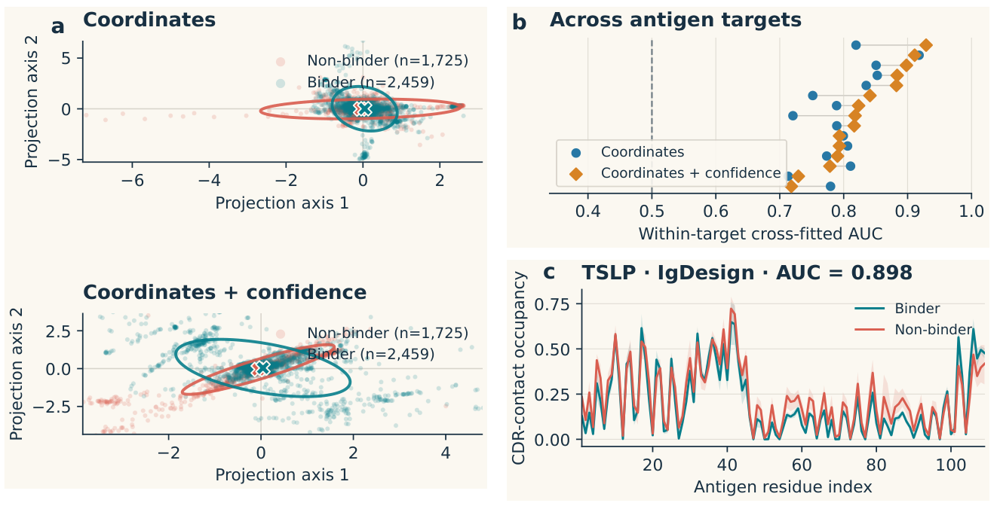
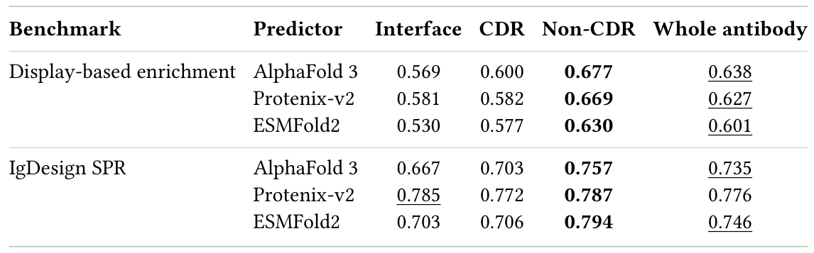
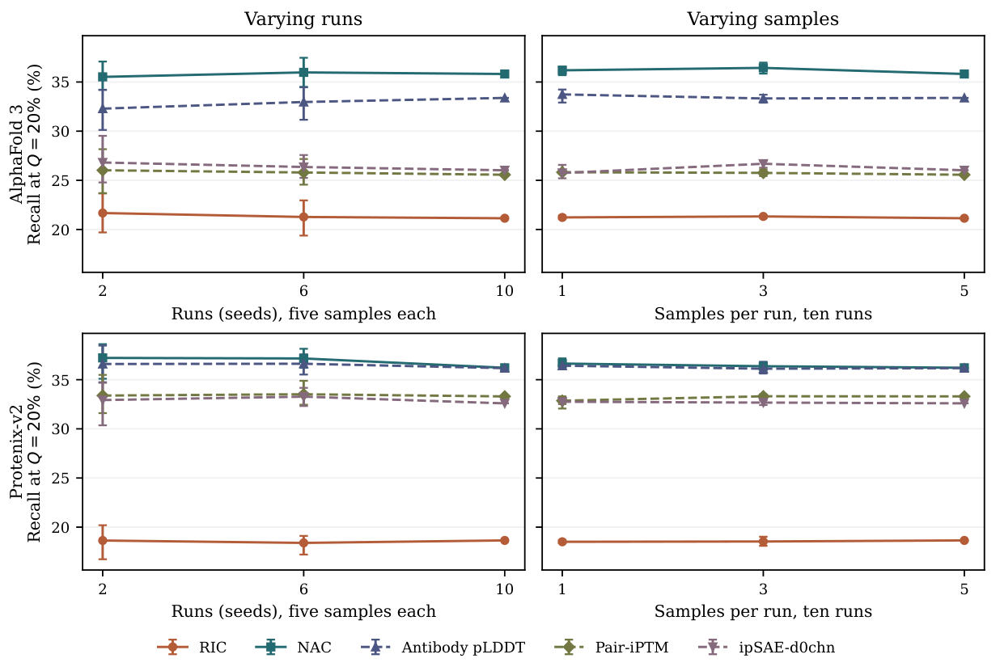

<div align="center">

# Revisiting Structure-Based Filtering for AI-Designed Antibodies

### Opportunities, Limits, and What Matters

**Which signals in predicted structures help select antibodies for experimental testing?**

[](paper/antibody-filtering.pdf)
[](pyproject.toml)
[](docs/prediction.md)

[Read the paper](paper/antibody-filtering.pdf) &nbsp; / &nbsp;
[Quick start](#quick-start) &nbsp; / &nbsp;
[Datasets](#datasets) &nbsp; / &nbsp;
[From sequences](#from-sequences-to-scores) &nbsp; / &nbsp;
[Citation](#citation)

</div>

---

Structure prediction produces more than a proposed binding pose. Its confidence
and agreement across repeated predictions can also help prioritize candidates.
We study these signals on **4,184 experimentally characterized antibody-antigen
pairs**, across **three predictors** and **two filtering settings**.

This repository contains RIC and NAC, baseline scores, dataset preparation,
prediction adapters, and the evaluation code accompanying the paper.
The submitted manuscript is included as a [PDF](paper/antibody-filtering.pdf);
an arXiv link will be added when the record becomes available.

## What matters for filtering?

| Across antigens | Within one antigen |
| :--- | :--- |
| Candidates for different targets compete under a shared threshold or global ranking. | Candidates for the same target are ranked against one another. |
| **Interface evidence** is strongest in our benchmark comparisons. | **Antibody-level confidence**, especially outside the CDRs, is more informative. |
| **RIC** measures support for predicted CDR contacts across prediction runs. | **NAC** summarizes non-CDR antibody pLDDT. |

### Predictions contain useful, but incomplete, binding information

<a href="paper/antibody-filtering.pdf">
  
</a>

**Figure 1.** Adding confidence information improves average within-target
separability in the AlphaFold 3 analysis, while predicted contact regions can
overlap substantially between binders and non-binders. Better scores can extract
more information from predictions, but cannot recover distinctions the predictor
does not capture.

### Confidence outside the CDRs can be a stronger filtering signal

<a href="paper/antibody-filtering.pdf">
  
</a>

**Table 7.** Non-CDR pLDDT has the highest mean within-antigen AUC in all six
predictor-benchmark comparisons. This supports a trade-off between direct
relevance to binding and prediction reliability: a region less directly involved
in binding can still provide a stronger filtering signal.

<details>
<summary><strong>How much does ensemble size matter?</strong></summary>

<br>



**Figure 2.** On the evaluated campaign candidates, smaller ensembles preserve
much of the average fixed-budget ranking signal. Run selection still affects
individual results. The paper compares changes in both seeds and samples for
AlphaFold 3 and Protenix-v2.

</details>

## Quick start

Generate Tables 2, 3, and 4 from candidate labels and full-precision scores. This
requires Python and NumPy; no GPU or structure files are needed for this step.

Obtain `antibody_binding_datasets.zip` and `antibody_scores.zip` as described in
the [data guide](docs/data.md). Archive download links will be added with the
dataset release. Once the archives are in the repository directory:

```bash
python3 -m venv .venv
source .venv/bin/activate
python -m pip install -r environments/cpu.txt -e .

mkdir -p data results
unzip antibody_binding_datasets.zip -d data
unzip antibody_scores.zip -d data
python scripts/validate_dataset.py data/antibody_binding_datasets

python scripts/reproduce_tables.py \
  --dataset data/antibody_binding_datasets \
  --scores data/antibody_scores/scores \
  --populations data/antibody_scores/populations \
  --reference reference --output results
```

Outputs are available as **CSV**, **Markdown**, and **LaTeX**. Reference checks
compare every displayed value, including average ranks, without changing the
computed results. See the [evaluation guide](docs/evaluation.md) for utility,
thresholds, fixed budgets, target weighting, and ties.

## Datasets

| Benchmark | Antigen constructs | Binders | Non-binders | Candidates | Experimental evidence |
| :--- | ---: | ---: | ---: | ---: | :--- |
| Display-based enrichment | 7 | 700 | 700 | 1,400 | Selection-round enrichment and read counts |
| IgDesign SPR | 7 | 249 | 922 | 1,171 | Replicated SPR binding measurements |
| Literature/patent affinity | 165 | 1,510 | 103 | 1,613 | Curated SPR, BLI, and ITC affinity measurements |
| **Total** | **179** | **2,459** | **1,725** | **4,184** | |

Antigen counts refer to distinct constructs within each benchmark. Labels follow
the assay-specific definitions in the paper; display enrichment is not a direct
affinity measurement.

Each dataset has a sequence table, a metadata file, and field documentation.
`pair_id` links sequences, experimental evidence, and predictor scores. Explicit
population manifests preserve the paper's evaluation sets, including the 275
ESMFold2 exclusions. See [data formats and units](docs/data.md).

## From sequences to scores

The [prediction guide](docs/prediction.md) describes local MMseqs2-GPU MSA search,
AlphaFold 3, Protenix-v2, and ESMFold2 inference, output conversion, and scoring.
Model weights and MSA databases are obtained separately under their providers'
access and license terms.

```text
Sequences  →  Local MSAs  →  Prediction ensembles  →  RIC / NAC / baselines  →  Evaluation
```

The adapters share a validated output format while preserving model-specific
confidence information. RIC uses predicted contact probabilities; ESMFold2 uses
the geometric-contact variant, gRIC. Missing predictions or inconsistent chain
mappings are not averaged into partial ensembles.

## Repository guide

| Directory | Contents |
| :--- | :--- |
| [`src/abfilter/`](src/abfilter/) | RIC, NAC, baselines, prediction adapters, and evaluation |
| [`scripts/`](scripts/) | Dataset preparation, MSA search, inference, scoring, and table generation |
| [`configs/`](configs/) | Evaluation rules, paper model settings, and small test configurations |
| [`environments/`](environments/) | CPU dependencies and separate predictor constraints |
| [`reference/`](reference/) | Reference tables, archive checksums, and model asset identities |
| [`docs/`](docs/) | Data, evaluation, prediction, and validation documentation |
| [`paper/`](paper/) | Accompanying manuscript |

Run the tests with:

```bash
python -m unittest discover -s tests -v
```

Tests use synthetic inputs. Experimental labels are used for evaluation, not
score calculation. See [validation details](docs/validation.md) for the checks
performed and their scope.

## Citation

```bibtex
@misc{liang2026antibodyfiltering,
  title  = {Revisiting Structure-Based Filtering for AI-Designed Antibodies:
            Opportunities, Limits, and What Matters},
  author = {Liang, Langzhang and Qian, Juncheng and Ma, Xiaojie and Zou, Mingxi
            and Xu, Yinghui and Xu, Zenglin and Ying, Tianlei},
  year   = {2026},
  url    = {https://github.com/Jinx-byebye/Antibody-filtering}
}
```

Predictor software, weights, databases, and third-party methods retain their
respective licenses and attribution requirements. Dataset licensing information
will accompany the data release.
